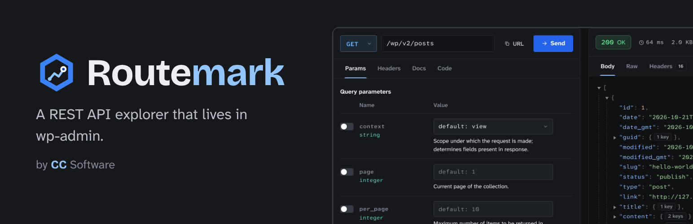
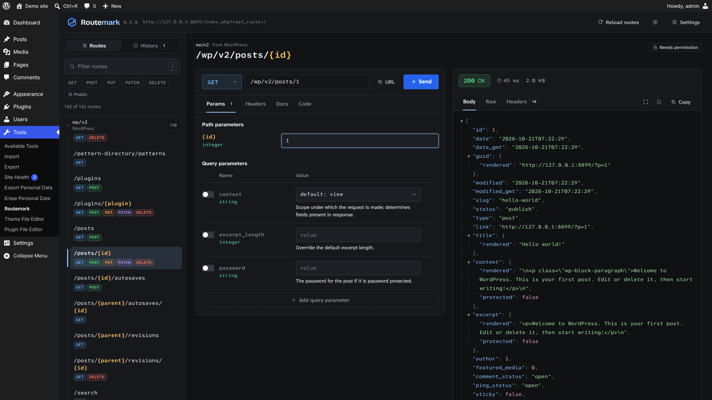
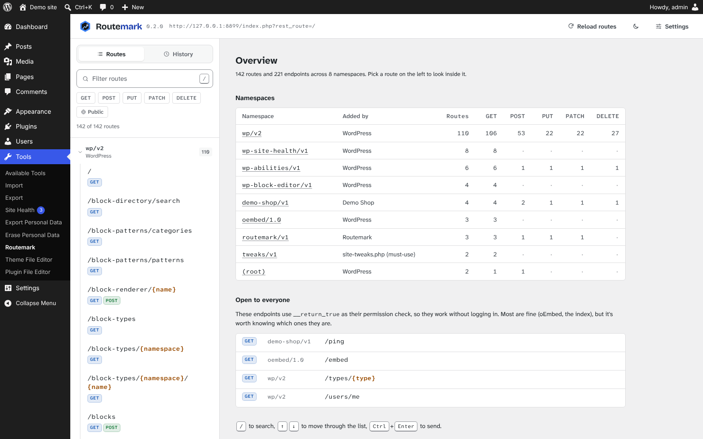
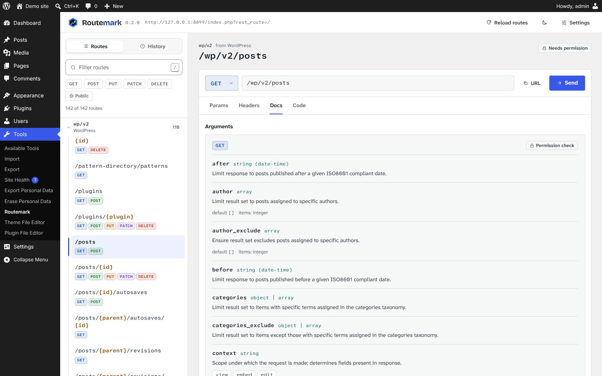

<p align="center">
  
</p>

Routemark is a WordPress plugin that lists every REST API route on your site, shows you what each one expects, and lets you send requests to it from wp-admin, logged in as yourself. It's the stuff you'd normally do with Postman, a browser console and a lot of guessing, but on one page under Tools.

It works with whatever is installed. Core, WooCommerce, form plugins, your theme, that one plugin a previous developer left behind: if it registers a route, Routemark shows it and tells you who added it.

Requires WordPress 6.6+ and PHP 7.4+. Free and GPL. It doesn't talk to any outside server.

<p align="center">
  
</p>

## What you'd use it for

**"Which plugin added this endpoint?"**
You've taken over a site with 30 plugins and something keeps showing up under `/wp-json/`. Open the overview and the namespaces table tells you which plugin, theme or must-use plugin registered each one. Type a plugin name in the filter ("woo", "form") and you get just its routes.

**Checking what's open to the public**
The overview has a list of every endpoint that anyone can call without logging in (permission callback set to `__return_true`). Most of them are fine, like oEmbed or a store's cart endpoint. But if your own custom endpoint is in that list and you didn't mean it to be, you'll want to know before someone else finds it.

**Testing your own endpoint while you build it**
Register a route, hit Reload routes, and it's there with its arguments listed. Fill in the parameters and send. There's no nonce to copy and no application password to set up, because you're already logged in. When it returns a 400, the WordPress error code and message are shown at the top instead of buried in the JSON.

**Front-end or headless work**
Before you write the fetch call, look up the route: which arguments it takes, their types and defaults, which values an enum allows, and what the response schema looks like. Then send it, check the result, and copy it as code:

```js
apiFetch( {
	path: "/wp/v2/posts?per_page=5&status=publish",
	method: "GET",
} ).then( ( data ) => console.log( data ) );
```

**Debugging a WooCommerce integration**
Something syncing products is getting odd results. Send the same request yourself, look at the raw response and the headers (`X-WP-Total`, `X-WP-TotalPages`), change one parameter and send again. History keeps what you've tried, so you can go back to an earlier request.

**Calling a route from PHP instead**
Sometimes the answer is "don't do an HTTP request at all". The Code tab also gives you the `rest_do_request()` version, handy for a cron job or WP-CLI command:

```php
$request = new WP_REST_Request( 'GET', '/wc/v3/products' );
$request->set_query_params( array(
	'stock_status' => 'outofstock',
) );
$response = rest_do_request( $request );
$data     = rest_get_server()->response_to_data( $response, false );
```

**Handing a request to someone else**
Copy as cURL and send it to a colleague or paste it in a ticket. They swap in their application password and run it:

```bash
curl -X POST 'https://example.com/wp-json/wp/v2/posts' \
  -u 'USERNAME:APPLICATION_PASSWORD' \
  -H 'Content-Type: application/json' \
  -d '{
  "title": "Hello from Routemark",
  "status": "draft"
}'
```

## Install

Download `routemark-x.y.z.zip` from [Releases](https://github.com/ClearanceClarence-Software/Routemark/releases), then in WordPress go to Plugins > Add New > Upload Plugin. Open it from Tools > Routemark.

Use the zip attached to the release, not the "Source code" zip GitHub adds automatically. That one is this repo and needs building first.

A couple of things worth knowing before you start:

- Only administrators can open it (`manage_options`).
- Requests are real. A DELETE deletes. Try things on a local or staging site first. By default Routemark asks you to click Send twice for DELETE, and in Settings you can make that apply to anything that isn't a GET.
- Request history stays in your browser and never goes in the database. Passwords, tokens and auth headers are blanked before it's saved.

<table>
  <tr>
    <td></td>
    <td></td>
  </tr>
  <tr>
    <td align="center">Overview: namespaces, who added them, and what's public</td>
    <td align="center">Docs tab: arguments, types, defaults and allowed values</td>
  </tr>
</table>

---

## Development

You need Node 20+ and a WordPress 6.6+ site to load it in.

```bash
npm ci
npm start          # rebuild on change
npm run build      # one-off build into build/
npm run typecheck
npm run zip        # build + dist/routemark-<version>.zip
```

Symlink or copy the folder into `wp-content/plugins/` and activate it. On XAMPP that's `C:\xampp\htdocs\<site>\wp-content\plugins\routemark`.

```
routemark.php                 plugin header, constants, bootstrap
uninstall.php                 deletes the settings meta when the plugin is deleted
includes/
  class-admin.php             Tools page, loads the app
  class-routes-controller.php GET routemark/v1/routes
  class-route-source.php      works out which plugin/theme registered a route
  class-settings.php          per-user settings, GET/POST routemark/v1/settings
src/                          the React app (TypeScript)
scripts/zip.mjs               builds the install zip from an explicit file list
webpack.config.js             stock wp-scripts config, minification off
postcss.config.js             same for CSS
.wordpress-org/               icon, banners and screenshots for the plugin directory
```

### How a few things work

WordPress doesn't record who registered a route, so `Route_Source` looks at the route's callback, finds the file its class or function lives in and matches that against wp-includes, the plugins folder, mu-plugins and the theme. It uses the class of the actual object, not the class that declares the method, because lots of plugins extend `WP_REST_Posts_Controller` and should still get the credit. Symlinked plugin folders are mapped back through `$wp_plugin_paths`.

Route patterns like `(?P<id>[\d]+)` become `{id}` by walking the string and counting parens. A single regex won't do it, because core's plugins route has a group nested inside the named one.

Requests go through `@wordpress/api-fetch` with `parse: false`, so we get the raw `Response` for status, headers and timing. In that mode it throws the Response on 4xx/5xx instead of returning it, which `send()` catches.

`Settings::schema()` is the one list of what each setting can be. It feeds the REST args, the defaults and the check when reading from user meta. The TypeScript `Settings` type mirrors it.

### Security

The PHP only prints a few fixed strings, through `esc_html__()`, `esc_html_e()` and `esc_url()`. Data for the page goes in through `wp_add_inline_script()` as JSON with `JSON_HEX_TAG | JSON_HEX_AMP`. Everything else is rendered by React, with no `dangerouslySetInnerHTML`.

The only input is the settings endpoint. Its args use `rest_validate_request_arg` and `rest_sanitize_request_arg` against the schema, so bad values get a 400. Nothing reads `$_GET`, `$_POST` or `$_SERVER`.

All requests use cookie auth with the `wp_rest` nonce, which api-fetch sends as `X-WP-Nonce`. Every endpoint also checks `current_user_can( 'manage_options' )`.

Run `phpcs` in the repo root to check against the WordPress Coding Standards (it picks up `phpcs.xml.dist`). It should come back clean.

### Releasing

1. Bump the version in `routemark.php` (header and `ROUTEMARK_VERSION`), `package.json` and `Stable tag` in `readme.txt`, and add a changelog entry to `readme.txt`.
2. Commit, then `git tag v0.1.4 && git push --follow-tags`.
3. The release workflow checks the tag matches the version, builds the zip and attaches it to a GitHub release.

The zip only holds `routemark.php`, `uninstall.php`, `readme.txt`, `includes/`, `build/` and `licenses/`. The JS in `build/` is compiled but not minified, and `readme.txt` links back here for the source, which is what WordPress.org asks for. So keep this repo public.

### Brand


Routemark is a CC Software plugin, so it uses the CC Software look. The name is one word with a capital R. In the wordmark, "Route" is in the text color and "mark" is in blue.

The mark is the CC Software hex well with a route running to a marker inside it. The well is always graphite, so the same mark works on light and dark backgrounds.

| | |
| --- | --- |
| Blue `#3B82F6` | Outer hex |
| Light blue `#93C5FD` | Route line, "mark" in the dark theme |
| Dark blue `#1E40AF` | "mark" on light backgrounds, marker center |
| Graphite `#16181B` | Hex well, icon background, dark theme |

The light theme has no palette of its own. It uses wp-admin's grays and the user's admin color scheme (`--wp-admin-theme-color`), so it looks like the rest of the dashboard. The dark theme uses the blues above, with `#2563EB` for the main button.

The wordmark is set in Bricolage Grotesque. Everything else uses Atkinson Hyperlegible Next and Mono, picked because they keep `l`, `I` and `1` apart, which matters when you're reading IDs and keys all day. All three are bundled with the plugin under the OFL.

### Ideas for later

- TypeScript types generated from route schemas
- OpenAPI export
- Saved requests and environments (local, staging, live)
- Sending as a different user or role
- A report of routes with no schema or loose permission callbacks

Routemark was called Restbench before its WordPress.org review. Same plugin, new name.

## License

GPL-2.0-or-later. See [LICENSE](LICENSE). The bundled fonts are under the SIL Open Font License 1.1, see `licenses/`.
